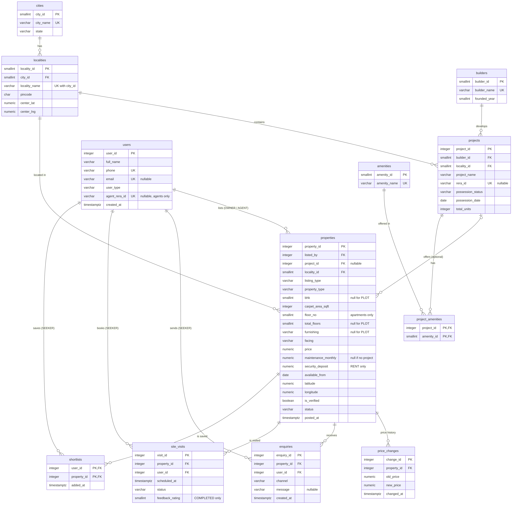
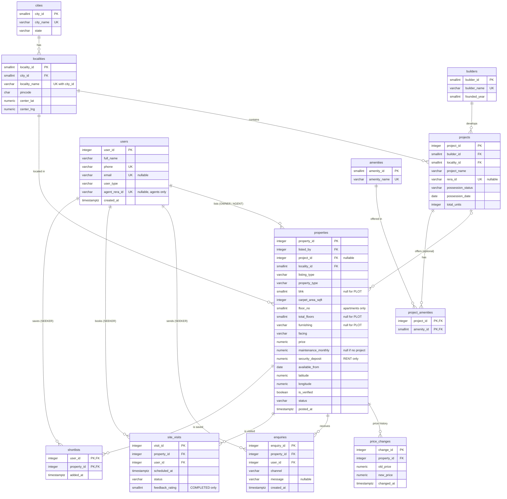

# Phase 2: Schema design (Team T0019 DolFin)

Files: `sql/01_schema.sql` (12 tables in schema `housing`), `sql/02_load_data.sql` (loads the 12 CSVs and runs the checks below), `diagrams/er_diagram.png`.
Tested on PostgreSQL 16.15: schema creates without errors, all 12 files load, row counts match the brief, and the unchanged 30-query workload runs without any error.
Every constraint was first tested against the seed data with a script, then proven by the real load.

**Method.** The seed data was profiled column by column (types, NULL counts, distinct counts, value sets, formats), then cross-checked table against table (orphans, who does what, which NULLs go together). Nothing below is a guess about the data: where we say "always", the check found 0 exceptions.

---

## 1. Data dictionary

Type choices: ids are `smallint` (dimension tables with at most a few thousand rows) or `integer`; money is `numeric` (never float); timestamps are `timestamptz` because every CSV value carries a `+05:30` offset; yes/no is `boolean` (CSV `t`/`f`); short codes are `varchar` with a CHECK. `pincode` is `char(6)` (a code, not a number: leading zeros are valid). `phone` is `varchar(10)` for the same reason.

### cities (10 rows)
| Column | Type | Constraint | Why |
|---|---|---|---|
| city_id | smallint | PK | surrogate key, 10 rows |
| city_name | varchar(50) | NOT NULL, UNIQUE | natural key, no duplicates in data |
| state | varchar(50) | NOT NULL | Maharashtra appears twice (Mumbai, Pune), so state is not unique |

### localities (100 rows)
| Column | Type | Constraint | Why |
|---|---|---|---|
| locality_id | smallint | PK | |
| city_id | smallint | NOT NULL, FK → cities, ON DELETE RESTRICT | a locality always belongs to a city; deleting a city with localities must be blocked |
| locality_name | varchar(60) | NOT NULL, UNIQUE (city_id, locality_name) | a name is unique inside a city, not necessarily across cities |
| pincode | char(6) | NOT NULL, CHECK `^[0-9]{6}$` | Indian pincode format; not made UNIQUE because in real life localities share pincodes (it happens to be unique in the sample) |
| center_lat, center_lng | numeric(9,6) | NOT NULL, CHECK inside India (lat 6–38, lng 68–98) | map centre, 6 decimals as in the CSV |

### builders (150 rows)
| Column | Type | Constraint | Why |
|---|---|---|---|
| builder_id | smallint | PK | |
| builder_name | varchar(80) | NOT NULL, UNIQUE | 150 distinct names |
| founded_year | smallint | NOT NULL, CHECK 1800–2100 | a year, not a date; data is 1960–2019. No dependence on `now()` so the rule never expires |

### projects (1,200 rows)
| Column | Type | Constraint | Why |
|---|---|---|---|
| project_id | integer | PK | |
| builder_id | smallint | NOT NULL, FK → builders RESTRICT | every project has a developer; keep history if a builder row is removed |
| locality_id | smallint | NOT NULL, FK → localities RESTRICT | |
| project_name | varchar(80) | NOT NULL | not UNIQUE: two builders can reuse a name |
| rera_id | varchar(19) | **nullable**, UNIQUE, CHECK `^[A-Z]{2}-RERA-PR-[0-9]{8}$` | 171 projects have no RERA id yet (114 ready-to-move, 57 under construction). UNIQUE allows many NULLs because NULL is never equal to NULL |
| possession_status | varchar(20) | NOT NULL, CHECK IN (READY_TO_MOVE, UNDER_CONSTRUCTION) | closed list |
| possession_date | date | NOT NULL | promised or actual date. Ready projects 2015–Feb 2025, under construction Jun 2025–Nov 2027. We do not fix this in a CHECK because "past/future" depends on today |
| total_units | integer | NOT NULL, CHECK > 0 | data is 100–999 |

### amenities (15 rows)
| Column | Type | Constraint | Why |
|---|---|---|---|
| amenity_id | smallint | PK | |
| amenity_name | varchar(40) | NOT NULL, UNIQUE | R09 looks up amenities by name |

### project_amenities (6,806 rows): M:N link
| Column | Type | Constraint | Why |
|---|---|---|---|
| project_id | integer | PK part 1, FK → projects ON DELETE CASCADE | a link row means nothing without its project |
| amenity_id | smallint | PK part 2, FK → amenities ON DELETE CASCADE | |

The **composite primary key (project_id, amenity_id)** is the identity of a link row (0 duplicates in the data) and also gives a free index on `project_id`.

### users (40,000 rows)
| Column | Type | Constraint | Why |
|---|---|---|---|
| user_id | integer | PK | |
| full_name | varchar(80) | NOT NULL | only 500 distinct names for 40,000 users, so it is *not* a key |
| phone | varchar(10) | NOT NULL, UNIQUE, CHECK `^[6-9][0-9]{9}$` | used to sign in (R23); Indian mobile numbers start with 6–9 |
| email | varchar(100) | **nullable**, UNIQUE, CHECK basic email shape | 15,990 users (40%) have no email, all 24,010 present values are distinct |
| user_type | varchar(10) | NOT NULL, CHECK IN (SEEKER, OWNER, AGENT) | 27,964 / 9,987 / 2,049 |
| agent_rera_id | varchar(16) | **nullable**, UNIQUE, CHECK `^AG-RERA-[0-9]{8}$` | only agents have one |
| created_at | timestamptz | NOT NULL | |
| *(table rule)* | | CHECK `(user_type='AGENT') = (agent_rera_id IS NOT NULL)` | only agents have an agent RERA id **and** every agent has one (0 exceptions) |

### properties (120,060 rows)
| Column | Type | Constraint | Why |
|---|---|---|---|
| property_id | integer | PK | ids are not contiguous (1…10,119,310), see data problems |
| listed_by | integer | NOT NULL, FK → users RESTRICT | owner or agent who listed it; never delete a user who has listings |
| project_id | integer | **nullable**, FK → projects RESTRICT | 54,009 listings are not part of a project (standalone) |
| locality_id | smallint | NOT NULL, FK → localities RESTRICT | needed even when the listing is in a project: standalone listings have no project to take it from |
| listing_type | varchar(4) | NOT NULL, CHECK IN (RENT, SALE) | |
| property_type | varchar(20) | NOT NULL, CHECK IN (APARTMENT, INDEPENDENT_HOUSE, VILLA, PLOT) | |
| bhk | smallint | **nullable**, CHECK 1–10 | empty exactly for plots (3,616) |
| carpet_area_sqft | integer | NOT NULL, CHECK > 0 | 730–4,199 |
| floor_no | smallint | **nullable**, CHECK ≥ 0 | filled exactly for apartments (ground floor = 0) |
| total_floors | smallint | **nullable**, CHECK ≥ 1 | empty exactly for plots |
| furnishing | varchar(20) | **nullable**, CHECK IN (UNFURNISHED, SEMI_FURNISHED, FULLY_FURNISHED) | empty exactly for plots |
| facing | varchar(12) | NOT NULL, CHECK IN (8 compass directions) | |
| price | numeric(14,2) | NOT NULL, CHECK > 0 | monthly rent (₹7,900–₹260,700) or sale price (up to ₹99.5 million); `numeric` because it is money |
| maintenance_monthly | numeric(10,2) | **nullable**, CHECK ≥ 0 | filled exactly when the listing is inside a project |
| security_deposit | numeric(12,2) | **nullable**, CHECK ≥ 0 | filled exactly for rentals |
| available_from | date | NOT NULL | |
| latitude, longitude | numeric(9,6) | NOT NULL, CHECK inside India | map pins (R05) |
| is_verified | boolean | NOT NULL, **DEFAULT false** | W01 inserts a listing without this column, so a new listing starts unverified |
| status | varchar(10) | NOT NULL, CHECK IN (ACTIVE, INACTIVE, RENTED, SOLD) | |
| posted_at | timestamptz | NOT NULL | |

Table-level rules (all hold for 100% of rows):
| Rule | CHECK |
|---|---|
| Floor cannot be above the building | `floor_no <= total_floors` |
| Plots have no BHK, furnishing or total floors; built properties always have them | `(property_type='PLOT') = (bhk IS NULL)` and the same for `furnishing`, `total_floors` |
| Only apartments have a floor number | `(property_type='APARTMENT') = (floor_no IS NOT NULL)` |
| Deposit only for rentals | `(listing_type='RENT') = (security_deposit IS NOT NULL)` |
| RENTED only for rentals, SOLD only for sales | `status <> 'RENTED' OR listing_type='RENT'`, `status <> 'SOLD' OR listing_type='SALE'` |
| Villas always belong to a project; houses and plots never do; apartments either | `ck_prop_project_by_type` |
| Maintenance is charged only for listings inside a project | `(project_id IS NULL) = (maintenance_monthly IS NULL)` |

### price_changes (23,425 rows)
| Column | Type | Constraint | Why |
|---|---|---|---|
| change_id | integer | PK | |
| property_id | integer | NOT NULL, FK → properties ON DELETE CASCADE | price history belongs to the listing |
| old_price, new_price | numeric(14,2) | NOT NULL, CHECK > 0, CHECK `new_price <> old_price` | a "change" must change something. In the data every change is a cut |
| changed_at | timestamptz | NOT NULL | |

Not UNIQUE on `property_id`: in the sample each property has at most one change, but the business model is one-to-many (several cuts over time).

### enquiries (100,000 rows)
| Column | Type | Constraint | Why |
|---|---|---|---|
| enquiry_id | integer | PK | |
| property_id | integer | NOT NULL, FK → properties RESTRICT | we keep enquiries as an audit trail; listings are retired with status, not deleted |
| user_id | integer | NOT NULL, FK → users RESTRICT | |
| channel | varchar(10) | NOT NULL, CHECK IN (CALL, WHATSAPP, FORM) | |
| message | varchar(200) | **nullable** | 50,057 enquiries (50%) have no free-text message (call / quick enquiry) |
| created_at | timestamptz | NOT NULL | |

### site_visits (35,120 rows)
| Column | Type | Constraint | Why |
|---|---|---|---|
| visit_id | integer | PK | |
| property_id, user_id | integer | NOT NULL, FK RESTRICT | same reasoning as enquiries |
| scheduled_at | timestamptz | NOT NULL | |
| status | varchar(10) | NOT NULL, CHECK IN (SCHEDULED, COMPLETED, CANCELLED, NO_SHOW) | |
| feedback_rating | smallint | **nullable**, CHECK 1–5 | |
| *(table rule)* | | CHECK `feedback_rating IS NULL OR status='COMPLETED'` | a rating only exists after a completed visit. The converse is not required: 6,427 completed visits have no rating |

### shortlists (69,999 rows): M:N between users and properties
| Column | Type | Constraint | Why |
|---|---|---|---|
| user_id | integer | PK part 1, FK → users ON DELETE CASCADE | a seeker's saved list goes away with the seeker |
| property_id | integer | PK part 2, FK → properties ON DELETE CASCADE | |
| added_at | timestamptz | NOT NULL | |

Composite primary key (user_id, property_id): a seeker saves a property once (0 duplicates).

### Summary of constraints created
12 primary keys (2 composite) · 15 foreign keys · 8 UNIQUE constraints · **43 CHECK constraints** (24 on `properties`) · NOT NULL on every column except the 12 that are legitimately empty (listed above in bold).
The brief asks for at least 12 CHECKs; the NULL-pattern rules (plots, deposit, maintenance, rating, agent id) are the ones that encode real business rules.

### ON DELETE rules at a glance
| Relationship | Rule | Reason |
|---|---|---|
| localities→cities, projects→builders/localities, properties→users/projects/localities | RESTRICT | master and reference data; deleting it would orphan or silently remove listings. Retire a listing with `status`, do not delete |
| enquiries/site_visits → properties/users | RESTRICT | business history and audit trail |
| project_amenities → projects/amenities | CASCADE | pure link rows |
| price_changes → properties | CASCADE | history is part of the listing |
| shortlists → users/properties | CASCADE | personal bookmark list |
| `properties.project_id` is **not** SET NULL | | SET NULL would break the rule that villas must have a project and would leave maintenance without a project |

---

## 2. ER diagram



Mermaid source (also saved as `diagrams/er_diagram.mmd`):



### Relationships and cardinalities
| Relationship | Cardinality | Note |
|---|---|---|
| cities – localities | 1 : N | 10 localities per city |
| localities – projects | 1 : N | |
| builders – projects | 1 : N | |
| localities – properties | 1 : N | every listing has a locality |
| projects – properties | 1 : N, **optional** on the property side | 54,009 listings have no project |
| users – properties | 1 : N | listing user is an OWNER or AGENT |
| projects – amenities | **M : N** via project_amenities | |
| properties – price_changes | 1 : N | |
| users – properties via enquiries | **M : N** with attributes (channel, message, time) | a seeker can enquire about many properties and a property gets many enquiries |
| users – properties via site_visits | **M : N** with attributes (time, status, rating) | |
| users – properties via shortlists | **M : N** | |
| (user, property) enquiry ↔ site visit | 1 : 0..N, **not enforced** | every visit has an earlier enquiry by the same user for the same property (0 exceptions), but a composite foreign key would need a unique key on enquiries(property_id, user_id) that the model does not require |

---

## 3. Functional dependencies and normal form

Notation: `A → B` means A determines B. "Key" = candidate key.

| Table | Candidate keys | Functional dependencies | Normal form |
|---|---|---|---|
| cities | city_id; city_name | city_id → city_name, state | BCNF. (`state` depends only on the key: city → state, never the reverse) |
| localities | locality_id; (city_id, locality_name) | locality_id → city_id, name, pincode, lat, lng | BCNF |
| builders | builder_id; builder_name | builder_id → name, founded_year | BCNF |
| projects | project_id; rera_id | project_id → builder, locality, name, rera_id, status, date, units; rera_id → project_id | BCNF (both determinants are keys) |
| amenities | amenity_id; amenity_name | | BCNF |
| project_amenities | (project_id, amenity_id) | none beyond the key (all attributes are in the key) | BCNF |
| users | user_id; phone; email; agent_rera_id | all attributes depend on user_id; phone → user_id, email → user_id, agent_rera_id → user_id | BCNF. (agent_rera_id is NULL for non-agents, enforced by CHECK) |
| properties | property_id | property_id → everything else. See the two redundancies below | **3NF, with one deliberate violation (below)** |
| price_changes | change_id | change_id → property_id, old_price, new_price, changed_at | BCNF |
| enquiries | enquiry_id | enquiry_id → property_id, user_id, channel, message, created_at | BCNF |
| site_visits | visit_id | visit_id → property_id, user_id, scheduled_at, status, rating | BCNF |
| shortlists | (user_id, property_id) | (user_id, property_id) → added_at | BCNF |

### Derived or redundant columns and whether to keep them
| Column | Redundant with | Verdict |
|---|---|---|
| price per sq ft | `price / carpet_area_sqft` | **Not stored.** Computed in queries (R02, R04, R15). A stored copy would go stale on every price change |
| `properties.price` | the latest `price_changes.new_price` | Matches for 100% of the 23,425 changed properties (check I2). **Keep:** every search reads the current price, and recomputing it from history on every read would be a join plus sort per row. The history table records the previous prices. Cost: both must be updated together (W02 updates only `properties.price`, so a production design would add a trigger or write both in one transaction) |
| `properties.locality_id` | `projects.locality_id` when `project_id` is set | Matches for 100% of the 66,051 in-project listings (check I1). This is a transitive dependency (property → project → locality), so strictly it breaks 3NF for those rows. **Keep:** standalone listings have no project to take it from, and R01/R02 filter by locality without joining projects. Risk: the two could disagree; mitigated by the I1 integrity check |
| `localities.city_id` → city | `properties` has locality, city is derived | Not duplicated in `properties`; reached by one join |
| `maintenance_monthly`, `security_deposit` | | Not derived; null patterns are encoded in CHECKs |
| `site_visits` (property, user) | an earlier enquiry | Business rule, not a stored copy |

---

## 4. Integrity checks (output of `sql/02_load_data.sql`)

**Row counts: all 12 tables match the brief**

| table | loaded | expected | result |
|---|---:|---:|---|
| amenities | 15 | 15 | OK |
| builders | 150 | 150 | OK |
| cities | 10 | 10 | OK |
| enquiries | 100,000 | 100,000 | OK |
| localities | 100 | 100 | OK |
| price_changes | 23,425 | 23,425 | OK |
| project_amenities | 6,806 | 6,806 | OK |
| projects | 1,200 | 1,200 | OK |
| properties | 120,060 | 120,060 | OK |
| shortlists | 69,999 | 69,999 | OK |
| site_visits | 35,120 | 35,120 | OK |
| users | 40,000 | 40,000 | OK |

**Our own integrity checks (violations found)**

| # | Check | Result |
|---|---|---:|
| I1 | a property inside a project has the project's locality | 0 |
| I2 | the current price equals the latest price change | 0 |
| I3 | only owners and agents list properties | 0 |
| I4 | only seekers send enquiries, book visits or shortlist | 0 |
| I5 | every site visit has an enquiry by the same user for the same property | 0 |
| I6 | no enquiry or shortlist is dated before the listing was posted | 0 |
| I7 | every price change is a cut and happened after posting | 0 |
| I8 | *info:* listings with NULL `project_id` | 54,009 |
| I9 | *info:* projects with NULL `rera_id` | 171 |

Extra proof that the schema and the workload fit together: the unchanged 30 queries of `queries/workload_30.sql` (25 reads and 5 writes inside a transaction that is rolled back) ran against this schema with no error.

---

## 5. Data problems and surprises we found

1. **54,009 listings (45%) have no project.** They are all independent houses (13,434), all plots (3,616) and 36,959 apartments. Any `NOT IN (SELECT project_id FROM properties)` therefore evaluates to UNKNOWN for every row. **R13 ("projects with no listings") returns 0 rows, but the correct answer is 120 projects** (verified: `NOT IN` → 0, `NOT EXISTS` → 120). This is the wrong-result query of Phase 4.
2. **171 projects have no RERA id.** `UNIQUE` still holds because NULLs are never equal; the column must stay nullable. R10 looks projects up by RERA id through the index that UNIQUE creates.
3. **Property ids are not contiguous.** Ids run from 1 to 10,119,310 for 120,060 rows. Exactly 60 rows have ids above 10,000,000, and they are the second copy of the 60 "same flat listed twice" pairs (R18: 60 groups × 2 copies), i.e. deliberately planted duplicates. We must not assume `property_id` is 1…N, and we did not add a UNIQUE constraint on (lister, locality, area, floor, bhk): it would have rejected the load.
4. **Dates beyond the brief's window.** The brief says listings run to 30 Jun 2026, but one property (10,119,310, a planted-duplicate row) was posted on 6 Jul 2026; 3,746 shortlists were added on or after 1 Jul 2026 (latest 11 Aug 2026) and 2,820 site visits are SCHEDULED on or after 1 Jul 2026. The workload treats 1 Jul 2026 as "now". So we have **no** CHECK that compares dates with today.
5. **One listing becomes available before it was posted** (property 10,107,670: available 11 May 2026, posted 14 May 2026), so `available_from >= posted_at` is not a valid constraint.
6. **Ratings are optional even after a completed visit.** 14,694 completed visits have a rating, 6,427 have none; every non-completed visit has none.
7. **Maintenance and project go together**, even for rentals: maintenance is empty for exactly the 54,009 standalone listings. Security deposit is empty for exactly the 54,060 sales (deposits are 2 to 12 times the monthly rent).
8. **Only 500 distinct names for 40,000 users** and 40% of users without an email: neither can be a key. Phone is the only always-present unique identifier.
9. **Every price change is a price cut** and each property has at most one change in the sample (23,425 changes for 23,425 properties). We still model it as one-to-many.
10. **2 agents have no listings and 120 projects have no listings**; 2,047 of 2,049 agents have at least one.

## 6. Indexes that exist after Phase 2 (Phase 2 rule: constraints only)

Only the indexes PostgreSQL creates automatically for PRIMARY KEY and UNIQUE exist (20 in total, 12 PK + 8 UNIQUE). **No foreign-key column has its own index**, and `properties` has only `properties_pkey`.

| Table | Indexes (auto-created) | Size |
|---|---|---:|
| properties | properties_pkey | 2,640 kB |
| enquiries | enquiries_pkey | 2,208 kB |
| users | users_pkey, uq_users_phone, uq_users_email, uq_users_agent_rera_id | 896 / 1,248 / 1,736 / 400 kB |
| shortlists | shortlists_pkey (user_id, property_id) | 1,552 kB |
| site_visits | site_visits_pkey | 784 kB |
| price_changes | price_changes_pkey | 528 kB |
| project_amenities | project_amenities_pkey (project_id, amenity_id) | 168 kB |
| projects | projects_pkey, uq_projects_rera_id | 48 / 72 kB |
| cities, localities, builders, amenities | pkey + UNIQUE each | 16 kB each |

This is the "no tuning" baseline that Phase 3 will measure. Table sizes: properties 20 MB, enquiries 9.5 MB, users 8 MB, shortlists 4.6 MB, site_visits 3.1 MB.

## 7. How to reproduce

```bash
createdb dolfin
psql -d dolfin -f sql/01_schema.sql
unzip seed_data.zip                      # do not commit seed_data/
psql -d dolfin -f sql/02_load_data.sql   # loads, ANALYZEs, prints the checks above
```
